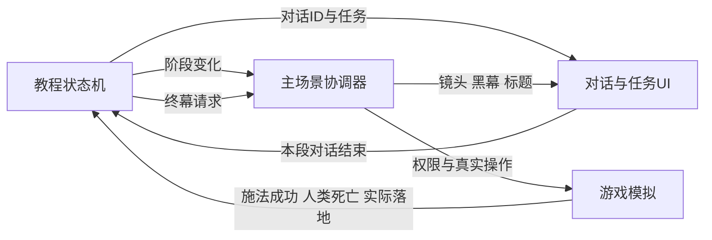
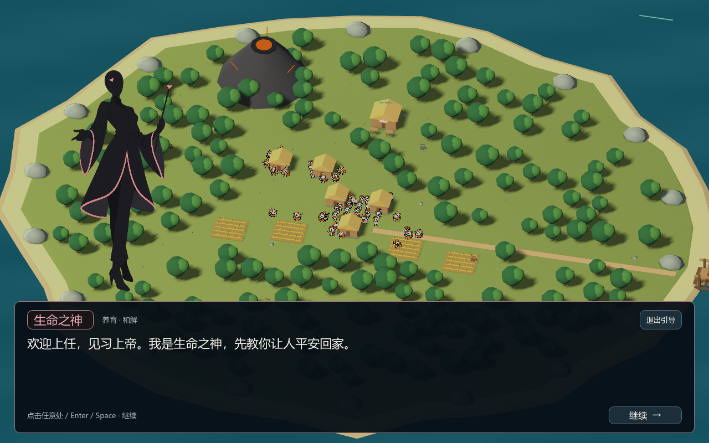

# 神明也疯狂序章复刻技术说明

本说明供接手的 AI 或开发者复刻现有序章，涵盖剧情、逐字对白、角色立绘、任务推进、真实施法、镜头终幕、存读与验收。基准是2026年10月31日 `C:\god` 中的 **Godot 三神版序章**，不是手机版当前“300秒收60魂”的普通挑战，也不是早期四神方案。本文及同目录材料是说明和参考，不会自动接入手机版。

**先读第1至5节确定规则，再实现第6至11节，移植手机版必须检查第12节，最后按第14节验收。** 完整原文见 [tutorial_story.json](data/tutorial_story.json)，机器可读流程见 [prologue_spec.json](data/prologue_spec.json)。无需根据聊天记录猜测对白或判定条件。

## 1 必须保留的体验与边界

玩家是沉默的见习上帝。生命之神先教玩家停止战争、照顾子民；天气之神帮助降雨；玩家亲手把两个古代聚落养成现代文明后，死亡之神才揭示收魂考核。玩家必须对刚养起来的人动手，最后亲自点击陨石按钮，流星雨真正落下后，镜头推进、黑幕、标题“神明也疯狂”。

- 当前只出场 **生命之神、天气之神、死亡之神**。旧内部ID `love` 仍代表生命之神。不要重新加灾难之神。
- 不给玩家写台词、旁白式心理活动或代替玩家发表感想。不加入选择分支、奇遇或恐龙蛋教学。
- 对话是覆盖在真实游戏场景上的 Galgame 式演出；世界暂停，UI继续打字和淡入。不是播放一段替代游戏的假动画。
- 正常操作目标小于3分钟；不是180秒硬失败，也不能为追赶时间自动替玩家点击、跳过文字或补人口。
- 原版开局 **每国60人，共120人**；养成门槛 **总人口至少300，并且两国都进入现代**。
- 收割门槛是进入收割阶段后累计 **50名符合原因的人类死亡**。第一魂包含在50内，不是1＋50。
- 最后使用同一个 `meteor` 陨石按钮的3级形态，不能另加一个玩家可见的“流星雨”技能。
- 片尾标题下方不加标语或解释性字幕。原版标题上方有小字“入 职 培 训  ·  结 束”；这是上方眉题，不是下方副标题。
- 序章的免费技能权限、丰饶条件和末日扩张都只属于本局教程，不能污染主线或沙盒。

## 2 文件与模块分工

| 模块 | 负责 | 不应负责 |
| --- | --- | --- |
| TutorialScenario | 在建世界之前合并教程专属配置，创建有配套设施的真实开局 | 在玩家等待时直接补人口、粮食或科研 |
| TutorialDirector | 单向状态机、判定真实回执、请求对话与终幕 | 发粮、生人、扣灵力、杀人、画UI或直接操控相机 |
| TutorialDialogue | 左右立绘、发言高亮、逐字文字、任务条、黑幕标题、输入拦截 | 自行判定施法成功、人口达标或国家停战 |
| Host／Main | 连接模块，控制暂停、权限和选中技能；调用双边停火、相机与终幕扩张 | 用按钮被点击作为玩法成功证据 |
| 游戏模拟及技能系统 | 人口、经济、战争、科研、生命、尸体、费用与冷却的权威状态 | 把视觉特效当成已经发生的伤害 |

推荐连接关系：



参考实现： [导演](reference-code/tutorial_director.gd)、[对话UI](reference-code/tutorial_dialogue.gd)、[教程配置](reference-code/tutorial_scenario.gd)、[主场景接线摘录](reference-code/main_tutorial_excerpt.txt)。这些GDScript是可核对的参考，不是可独立运行的网页模块。

## 3 开局世界与教学加速

先复制正常模式配置，再仅在 `mode === tutorial` 时覆盖；之后才创建人口、设施和灵力账本。顺序颠倒会导致画面人数、住房容量和模拟参数不一致。

| 项目 | 原版教程值 |
| --- | --- |
| 初始人口 | 两国各60位真实居民 |
| 初始灵力 | 120，属于初始来源，不是收魂收入 |
| 初始食物 | 每国3年口粮；按每人每年2粮计算，即每国360粮 |
| 时间 | 1游戏年＝30模拟秒；普通教学阶段默认3倍速 |
| 住房 | 每屋15人；每国开局5座完工民房，容量75 |
| 生产设施 | 农耕国4片完工农田；畜牧国6座完工牧场，每场4只羊，共24只 |
| 科研设施 | 两国各1座完工学院；学士仍要有劳力、粮食并实际到院工作 |
| 自然生育年率 | 0.5；不是每秒生育率 |
| 普通施工 | 2模拟秒，仍需真实施工人员 |
| 农田产量 | 每片每年100粮 |
| 牲畜肉 | 每只实际屠宰出40粮；繁育间隔0.5游戏年 |
| 科研 | `civilization_research_per_scholar`、`scholar_research_per_year`均覆盖为每年8点 |
| 开局时代 | `era = 0`、`science = 0` |
| 现代判定 | 科研达到30点进入 `era = 1`；`era >= 1`均满足教程条件 |
| 常规终局 | 关闭年限、普通魂数胜利和科技终局；保留提前灭绝的失败，直到进入最终施法阶段 |

原版国土中心约为 `(-30,0.38,0)`、`(30,0.38,0)`。移植时改用目标项目自己的岛屿坐标，不要照抄坐标移动已有地编。

开场设置两国关系25，发出一个真实冲突请求“为桥上的通行与粮贸起争执”，推进一次战争系统以建立真实集结状态。再显示首段对话并冻结世界。并非开局先杀掉一批人，也不是摆一支只用于演出的假军队。

“见习丰饶祝福”要在养成任务中明确说明；这是一组公开的教程条件。不要直接把人口设成300或把时代字段改成现代来代替养成。

## 4 完整状态机

`phase`按下表顺序单向推进。每个阶段还可以有一个活动中的`dialogueId`，两者不是同一个字段。对白未结束时不检测跳到下一养成任务。达标后即使人口被收割到300以下，也不回退阶段。

| phase | 入场动作／对白 | 唯一推进条件 | 下一步 |
| --- | --- | --- | --- |
| intro | 只显示生命神明；播放`intro` | 该段对白结束 | peace |
| peace | 自动选和解，镜头聚焦真实在任国王；显示停火任务 | 对任意一位活着的在任国王成功付费施放和解，目标确实获得和解状态 | weather |
| weather | 撤销双边军令和集结、召回两国士兵；播放`peace_done`，结束后立即播放`weather_intro` | `weather_intro`结束 | rain |
| rain | 开放气候，默认恒温＋多云，自动选气候并聚焦农耕岛 | 有效付费施法已落地，目标岛实际为雨天 | stewardship，并播放`rain_done`后接`stewardship` |
| stewardship | 显示人口／时代双目标；镜头回双岛概览；维持教程停战 | 对话全部结束，`floor(pop0)+floor(pop1)>=300` 且两国`era>=1` | harvest |
| harvest | 保存当前累计收魂收入为基线；开放收割技能、解除教程停战、自动选闪电；播放`harvest_reveal` | 一次或多次符合原因的真实人类死亡，累计至少1 | first_soul |
| first_soul | 播放`first_soul`；此时不把已有死亡数归零 | `first_soul`结束 | catastrophe，并播放`catastrophe` |
| catastrophe | 显示本阶段累计收割0至50的进度 | 对白结束且`harvestDeaths>=50` | final_cast |
| final_cast | 陨石升级为3级、自动选陨石；播放`before_finale` | 玩家付费释放产生有效流星雨事件，再收到该事件第一颗实际落地回执 | finale |
| finale | 隐藏HUD，1倍速，镜头推进、双岛灾变、黑幕、标题 | 演出至少10秒，且剧情灾难事件全部结束 | complete |
| complete | 世界冻结，显示完成面板 | 点击“开始主线挑战”或“返回主菜单” | 新建普通挑战／主菜单 |

`weather`、`first_soul`等阶段不是自由等待关。它们是对话过渡。`final_cast`内则必须区分“还没放”“已放出未落地”，不能把点击技能按钮或选择城镇当作进入终幕。

章节对应：1先学会爱（intro／peace）；2风调雨顺（weather／rain）；3你亲手养大的文明（stewardship）；4上帝也有考核（harvest／first_soul／catastrophe）；5神明也疯狂（final_cast及以后）。原版初次intro尚未发出阶段变更时，UI使用默认栏名“见习神明入职引导”。

## 5 技能和神明的阶段权限

| 解锁节点 | 可见神明 | 可用技能 |
| --- | --- | --- |
| intro／peace | 生命 | `reconcile`和解、`prosperity`安居乐业、`joy`欢愉 |
| weather对白 | 生命、天气 | 仍只有生命三技，天气刚登场 |
| rain／stewardship | 生命、天气 | 以上＋`climate`气候控制 |
| harvest开始 | 生命、天气、死亡 | 以上＋`lightning`、`meteor`、`rage`、`plague`、`undead` |
| final_cast | 同上 | 不新增按钮，只把`meteor`升为3级流星雨 |

教程阶段授予技能使用权，不收解锁／升级费用；**每次施法仍消耗灵力并检查冷却、目标和范围**。不允许通过技能商店绕过教学权限。

关键原版费用／冷却（模拟秒）：和解4／6、气候4／4、闪电1／1、普通陨石12／12、满级陨石18／18。完整数值复制在 [skills.json](data/skills.json)。不要误用手机版的闪电3灵力、气候5灵力等普通挑战配置来声称已精确复刻原版节奏。

`rain`、`meteor_shower`只是旧存档或内部事件兼容键，不新增可见技能。生命神明的内部ID保留`love`，无需改成另一个键导致存档和立绘找不到。

## 6 全部对白和左右站位

每行至少含`speaker`和`text`。可选`left`／`right`表示该槽位要显示谁：**省略字段＝保留该段上一行站位；空字符串＝清空槽位**。开始一个新conversation时两个槽位先清空。发言者不在任一槽位时，按默认站位自动补上：生命左，天气和死亡右。

以下文字直接从配置生成，不能为玩家补旁白。生命的温柔与死亡的公事公办，通过话语和听者暗下来的立绘表达。

| 段ID／行 | 发言者 | 左槽 | 右槽 | 原文 |
| --- | --- | --- | --- | --- |
| intro／1 | 生命之神 | love | 清空 | 欢迎上任，见习上帝。我是生命之神，先教你让人平安回家。 |
| intro／2 | 生命之神 | 继承 | 继承 | 两国正在备战。选择「和解」，点击任意一位国王，促成双方停火。 |
| peace_done／1 | 生命之神 | love | 继承 | 刀剑放下了，双方正在返乡。我请天气之神来帮忙。 |
| weather_intro／1 | 天气之神 | love | weather | 选择「气候控制」，选恒温、多云，再点岛屿。下雨能帮助生产；低温加多云则会下雪。 |
| rain_done／1 | 生命之神 | love | weather | 雨来了。粮食、房屋和学士，接下来都要照顾好。 |
| stewardship／1 | 生命之神 | love | weather | 让总人口达到300，双方进入现代。默认3倍速，教学祝福会加快发展。 |
| stewardship／2 | 生命之神 | 继承 | 继承 | 欢愉能促进生育，却会让人停工、吃得更多。先备粮，再赐福。 |
| harvest_reveal／1 | 生命之神 | love | 清空 | 街灯亮起来了。你照顾的每一户，都有了明天。 |
| harvest_reveal／2 | 死亡之神 | love | death | 死亡之神，灵魂归档科。养育完成，接下来是收魂考核。 |
| harvest_reveal／3 | 生命之神 | 继承 | 继承 | 等等，他们才刚安定下来。 |
| harvest_reveal／4 | 死亡之神 | 继承 | 继承 | 选择「天气之神 → 闪电」，点一位居民。灵魂入账，就会获得灵力。 |
| first_soul／1 | 死亡之神 | love | death | 一魂已归档，灵力到账。流程就是这样。 |
| first_soul／2 | 生命之神 | 继承 | 继承 | ……我还记得他们等第一场雨的样子。 |
| catastrophe／1 | 死亡之神 | love | death | 用陨石等技能，新增收集50魂。亡灵能复苏尸体继续收割；自然死亡不算考核。 |
| catastrophe／2 | 生命之神 | 继承 | 继承 | 这些人，是刚才亲手养大的。 |
| before_finale／1 | 天气之神 | love | weather | 指标已满。陨石已获满级祝福，选择「天气之神 → 陨石」，点击城镇，降下流星雨。 |
| before_finale／2 | 天气之神 | 继承 | 继承 | 把谢幕交给我。 |
| before_finale／3 | 生命之神 | 继承 | 继承 | …… |
| epilogue／1（预留不播放） | 生命之神 | love | 清空 | …… |

配置共19行、426字符，其中`epilogue`的一行“……”是预留内容，当前导演没有调用。**实际主线播放18行、424字符**；标题后直接完成面板，不擅自插入另一段尾声。上表保留预留行便于辨认。

## 7 开局对话的画面复刻



截图来自原项目已有验收，开局图是真实教程开局；后续死亡神明／标题参考图属于受控章节演出截图，仅用于构图参考，不能当作连续自然通关证据。

### 7.1 图层与构图

从后向前依次为：真实3D双岛世界 → 对话背景暗幕 → 左右透明立绘 → 底部对话面板。进入对话时隐藏游戏HUD和技能栏、清除技能瞄准预览、清除残留提示和镜头拖动。角色立绘没有3D碰撞，不参与世界坐标投影。

Godot层使用`CanvasLayer.layer=30`、`PROCESS_MODE_ALWAYS`。根Control铺满窗口且不拦截整个世界；对话表面铺满窗口并拦截输入；立绘和背景自身忽略鼠标，由对话表面接收点击。

| 元素 | 原版默认值 |
| --- | --- |
| 窗口 | 设计1440×900，最低1280×800；并未完成手机竖屏布局 |
| 场景暗幕 | RGBA约`(0.012,0.024,0.04,0.23)`；仍能看清自己养的城镇 |
| 对话面板 | 左26px、右26px、底18px；高度在窗口高<850时238，否则248 |
| 面板颜色 | RGBA`(0.025,0.055,0.085,0.94)`，1px边框、圆角9px |
| 内边距 | 左右23px，上下16px；纵向元素间距10px |
| 文字 | 浅色`#f2efe7`；字号22或23，自动换行，禁用富文本解析、选字与文本滚动 |
| 顶栏 | 发言者名牌（22px）＋身份说明（13px）＋章节（13px）＋“退出引导” |
| 底栏 | 左侧“立即显示／继续”提示；右侧宽132、高32的按钮 |
| 立绘容器 | 宽`min(360,屏宽×0.27)`，高`min(464,屏高×0.53)`；保比例完整显示，不拉伸 |
| 立绘位置 | 左距40；右距40；立绘底部在对话框顶部以上8px；支持独立scale与offset |
| 小窗口处理 | 宽度<1360时隐藏对话顶栏章节文字，保留姓名和正文 |

不用给角色添加呼吸骨骼、嘴型或表情动画才能复刻这一版；现有演出主要由透明PNG、淡入、发言高亮、逐字和场景切回构成。

### 7.2 神明资产和发言高亮

三位神明均为正常成人比例、黑色为主的大色块卡通立绘，头部是简洁面具，辅色和轮廓区分神职。它们与游戏里搞怪的小人明显不同。

| 内部ID | 显示名／身份 | 辅色 | 站位／资源 |
| --- | --- | --- | --- |
| love | 生命之神／养育 · 和解 | `#f0afbc` | 左侧，[love.png](portraits/love.png) |
| weather | 天气之神／云层服务部 | `#8fd2e7` | 右侧，[weather.png](portraits/weather.png) |
| death | 死亡之神／灵魂归档科 | `#c1afe8` | 右侧，[death.png](portraits/death.png) |

使用包内透明PNG；比例和alpha均应保留。发言者调制为白色，听者调制为`#c7ccd6f5`。姓名、名牌边框和对话框边框跟随发言者辅色。切换同一角色的发言状态时只渐变颜色；槽位更换角色时新立绘从alpha=0淡入目标色，默认0.26秒。开始新Tween前终止该槽位旧Tween，快速点按不能积累多段动画。当前实现没有两张旧／新立绘同时交叉淡出的要求。

资源加载失败时，先尝试默认立绘路径；仍失败则显示角色名占位，不能让对话无法继续。文件路径、scale、offset、modulate由资产配置管理；UI参数见 [ui.json](data/ui.json)。

### 7.3 逐字、停顿与点击

- 每行从0可见字符开始，默认38字符／真实秒。
- “。！？…”额外停顿0.10秒，“，；：”额外停顿0.045秒；原实现最后一个字符完成后直接结束打字。
- 正在打字时，点击对话区域／“显示全文”／Enter／小键盘Enter／Space只补全本行。
- 本行完整显示后，再次点击才前进一行。末行按钮显示“开始操作 →”，它结束当前conversation；有串联对白时仍会立即进入下一段，而非一定交还世界。
- 不设自动播放、不按字数倒计时强制翻页。不把38字符／秒当成人类阅读速度。
- 同一个渲染帧最多接受一次推进；显示新conversation也记录当前帧。否则同一鼠标事件经过父面板、按钮和快捷键可能连跳两句。
- 最后一句关闭的那一帧仍拦截世界输入，下一帧再允许施法。浏览器移植建议进一步消费完整pointer手势，防止关闭对话的pointerup落到地面施法。
- 对话中Space只推进对白，不触发暂停；数字键不能切技能；镜头拖动不能穿透。Escape退出引导，不是直接跳过全文。

浏览器使用Unicode码点或grapheme处理逐字，避免把emoji拆半；JSON文本用textContent／安全文本节点，不用innerHTML执行对白。

## 8 任务条与三套时间

对话关闭后隐藏立绘和暗幕，恢复HUD、技能和世界操作；上方显示可收起的任务面板。原版默认居中y=144，宽`min(602,max(390,屏宽−564))`；正文有滚动容器，收起仅折叠任务正文，不丢任务状态。

养成显示“总人口x/300 · 两国热兵器时代y/2”。进度是：

```text
progress = min(1, totalPopulation / 300) * 0.75 + modernCountryCount * 0.125
```

收割显示合格人类死亡累计数／50，同时显示“新增收魂灵力”。后者是 `累计souls来源收入 − 进入harvest时的收入基线`，不是当前灵力余额，施法花钱不会让进度倒退。

必须区分时间：

| 时钟 | 运行规则 |
| --- | --- |
| UI真实时间 | 逐字与立绘Tween。对话暂停世界时继续运行，不乘3倍速 |
| 游戏模拟时间 | 真实帧时间×gameSpeed；人口、粮食、兵员、科研、冷却、技能事件共用；对话中为0 |
| 终幕真实时间 | 从第一颗真实落地开始；切回1倍速，独立驱动镜头和黑幕。终幕中模拟继续执行灾难 |

原版每帧delta最大0.25秒，模拟子步最大0.1秒。移植可保留自己的固定步进，但所有系统要消费一致的模拟时间，不能让军队或冷却在世界暂停时偷偷推进。

## 9 触发回执与防止假推进

以下为跨引擎建议接口；字段在原版对应真实技能与死亡回执，不要求目标项目使用同样函数名：

```ts
type CastCommitted = {
  ok: true; castId: string; skill: string; nation: 0|1;
  point: {x:number,y:number,z?:number};
  targetId?: number; targetRole?: 'king'|'soldier'|'civilian';
  affectedCount?: number; eventId?: number;
};
type HumanDeathsCommitted = {
  receiptId: string; cause: string; byNation: [number,number];
};
type ActualImpact = {
  eventId: number; skill: 'meteor_shower'; radius: number;
  point: {x:number,y:number,z?:number};
};
```

新实现建议用receiptId去重。原版依赖权威死亡账本只发一次信号；同一技能的成功回执和死亡信号不能各加一次魂。

### 9.1 和解不能只修改屏幕上的“战争”字样

确认目标是活着的实际居民、当前`leader_id`、角色king、受影响数量>0且已获得和解状态后，进入weather并执行教程专用双边协定：

1. 撤销两国待发战争请求、旧集结队列与追击目标。
2. 两国国王获得和解状态，军人停止攻击，分配真实返乡目标。
3. 军人走回家后才脱离军籍；途中死亡和携带物资沿用真实账本。
4. 清除入侵压力、战争欲望、暴怒、怨恨和待复仇意图，关系提高到85。
5. `tutorialArmistice=true`持续到养成达标；不能只等待一个18秒普通buff到期就恢复战争。

对普通士兵施放和解只劝返该士兵，不完成教程停火任务。教程“一位国王促成双边和平”是专用规则，不能不加模式检查就扩散到所有普通对局。

### 9.2 降雨检查的是结果

成功施法回执中nation必须有效；原版岛屿`rain`必须高于默认0.22，且气候结果`climate_precipitation === rain`。选择天气卡、选中多云、阴天无雨、晴天、下雪、无效地面、费用不足均不推进。普通技能的准备／飞行结束后，气候已经真实写入岛屿状态，再通知导演。

### 9.3 人口、时代与收魂

养成读取权威人口账本，两国分别取floor后求和。现代读取每国真实era，不读取房屋模型、高楼数量或界面文字。允许任一国人口超过另一国，只要总计300且两国现代。

收割从harvest开始，按人类死亡原因过滤；当前接受 `lightning, meteor, meteor_shower, plague, disease, rage, undead, fire, volcano`，兼容旧原因 `transformation, halloween, ghost_parade`。自然衰老、饥饿、野兽、普通战斗、动物和骷髅本身死亡不计这50人的考核。仅原因名满足也不够，必须来自实际人类死亡提交，不读预测命中数。

第一击若一次杀掉50人以上，仍先播放`first_soul`，再播放`catastrophe`，读完才进入最终施法，不跳掉转折对白。首次死亡可能发生在施法成功通知之前，因此死亡只从独立账本监听，`notifyCast`不再加死亡数。

原版显示目标“收魂灵力25”，每魂默认0.5灵力，但**进入final_cast的实际门槛只有50个合格死亡**，不是再要求余额≥25。自然死亡收入也可能出现在累计souls来源里，所以该显示不能代替合格死亡计数。

## 10 流星雨终幕

只有完成50人收割并读完`before_finale`，玩家用陨石按钮付费产生连续流星雨事件，才记录`finaleCastArmed=true`和eventId。普通单发陨石、不存在的事件、失败施法均不能触发终幕。

收到对应事件的第一颗**实际落地**，并确认radius>0、坐标有限、内部skill为`meteor_shower`后才开始计时。原版兼容没有eventId的旧回执；新移植应提供并比对eventId，避免另一场陨石提前触发。

| 第一颗落地后的真实时间 | 画面和模拟 |
| --- | --- |
| 0秒 | 锁定世界输入、隐藏HUD、切1倍速，保存原相机焦点与正交size；扩大这次已付费事件为双岛灾变 |
| 0至2.2秒 | `smoothstep(0,2.2,t)`插值焦点到实际落点；正交size从原值插到8，相当于拉近镜头 |
| 2.2至3.3秒 | 黑幕alpha从0线性增加到1，世界灾难仍运行 |
| 3.3至4.7秒 | 黑幕保持1，标题组alpha在1.4秒内从0到1 |
| 4.7秒以后 | 保持“神明也疯狂”标题；不额外加下方文案 |
| 至少10秒且剧情事件已结束 | 进入complete；显示“新手引导已完成”，提供“开始主线挑战”和“返回主菜单” |

若目标项目用透视相机，把正交size插值转成等效距离或FOV变化，保持2.2秒平滑靠近的观感，不照抄size=8当作世界距离。

### 双岛毁灭如何实现

复用玩家最后一次已付费的流星雨事件，教程专用地扩展成两岛各一场，不能另扣费或算两次玩家操作。默认每岛9模拟秒、共36次落点（首颗计入第一岛的36次），约0.25秒一次；区域半径20，单次半径2.4，建筑伤害1.2。普通满级技能原来是区域6、24次、半径1.6；不要把序章扩展强度写回普通技能。

每次落点重新从当前存活的人和完好建筑选择目标，倾向摧毁建筑并穿插居民落点；击中房屋只结算实际在室内的居民，不按住房容量凭空生成死亡。死亡、尸体、灵魂、动物、树木和建筑仍走正常账本。设置一次性`finaleStarted`标记，再产生另一岛事件，防止落地回调递归生成无限流星。

“摧毁一切”是剧情演出目标，原版**并未要求最后人口必须为0**：完成条件是时间和事件结束。不要在黑屏瞬间执行`population=0`来伪造效果。final_cast及以后暂时屏蔽普通灭绝等结算，避免灾难先杀光人而截断标题；完成后用全新普通挑战场景开始，不能接着被毁的教程世界继续玩。


## 11 存档、退出与恢复

普通保存入口在对话演出、finale／complete、技能仍飞行、费用预约未结算时拒绝，并说明“交还操作后再保存”。允许在和平、降雨、养成、收割等已经交还控制的时刻保存。

导演状态至少包括：version、phase、started、dialogueId、两国停火标记与目标ID、降雨次数、养成曾达标标记、合格死亡数、收入基线、累计教程时间、终幕是否已武装、eventId、是否已落地、最终落点。只保存数据，不保存Node、函数、UI引用。

UI状态另存conversationId、完整行列表、lineIndex、可见字符数、typing、打字时钟、左右角色、章节、任务折叠状态、终幕显示状态。恢复时先校验状态一致性，再恢复世界和导演、重建权限、重建UI，避免先播放开场再恢复到收割。

关键校验：weather之后必须有双方接受停火；stewardship之后必须有真实降雨；harvest之后必须记录养成曾达标；first_soul之后死亡数≥1；final_cast之后≥50；finale之后必须有已释放与已落地标记。当前人口低于300不能否定历史上已达标的存档。

中途退出回主菜单；重开须清除技能临时权限、陨石3级祝福、旧回调、Tween和相机终幕计时，重新从120人／120灵力开始。结束按钮销毁当前场景要延后一帧或等当前信号栈返回，避免释放正在执行按钮回调的对象。

## 12 手机版移植前必须补齐的条件

`C:\god_mobile`现状与原版不同。这里只列接入要求，本次没有修改网页游戏代码或表现：

| 差异 | 对复刻的影响 | 处理方法 |
| --- | --- | --- |
| 每岛80人上限 | 两国最高160，永远达不到300 | 教程单独提高逻辑上限，至少允许总计300并留增长余量；渲染人数上限另算 |
| 默认8人、80粮、30灵力 | 无法直接获得原版开局与节奏 | 新建tutorial模式初始化60＋60、配套住房和生产、足够口粮与120灵力；勿修改普通挑战默认值 |
| 只有农耕学院和研究点，尚无完整era | 两国现代条件无法完成 | 教程也必须有两国真实学士／研究和era≥1的结果，不能等待不存在的字段或以高楼替代 |
| 两国普通经济与时间单位不同 | 原版0.5“每年”可能被错套为“每秒” | 明确yearSeconds，重新校准教程专属经济；原版数值是参考，不能混单位 |
| 技能名称键不同 | 状态机监听不到真正施法 | 适配 `reconcile→peace`、`prosperity→bless`、`climate→weather`；其余同名键按效果核验 |
| 气候只有晴／雨／热／冷快捷选项 | 不等同于“温度三选一＋云量二选一” | 表现方做原版选择器或明确提供教程适配；导演最终只接受真实雨天结果 |
| 陨石没有3级持续事件 | 点击后不能提供eventId和多次落地 | 玩法侧实现有界的连续灾难事件，再交给表现方绘制；不能用普通陨石动画假装流星雨 |
| 尚未接入原版Galgame界面和面具立绘 | 只有规则不能复现开局演出 | 表现方依据本文第7节和包内资产接入；玩法方提供事件和阶段快照 |
| 现有300秒／60魂普通胜利 | 可能提前结束教程或与50人考核混淆 | tutorial模式禁用普通胜利与计时，使用本文导演门槛 |
| 国王／动物显示与预览尚待对齐 | 玩家可能找不到国王或选错目标 | 接入实际role与统一命中预览，不改变地编固定位置 |

房屋固定摆放约束继续有效：可以在序章初始化更多**已有地编槽位**为完工，按教程容量提供75床位；不要为了复制Godot截图移动手机版已有房屋、学院或道路。

## 13 配置、材料和证据

本目录可以整体交给其他AI，不需要再找四神历史讨论：

- [prologue_spec.json](data/prologue_spec.json)：机器可读阶段、门槛、权限、事件、时序与教程参数；是说明数据，不是已经接入游戏的配置。
- [tutorial_story.json](data/tutorial_story.json)：原始完整对白，原样复制。
- [ui.json](data/ui.json)与[skills.json](data/skills.json)：原项目现行配置快照。目标项目应映射需要的字段，不要直接覆盖它的整份配置。
- [portraits.json](data/portraits.json)：可移植的角色名、颜色和相对图片路径。
- `portraits/`：三张现用面具神明透明PNG，不包含历史繁复设计或灾难之神。
- `screenshots/`：现有开局、天气登场、死亡登场和片尾参考图；后续章节图为受控演出参考。
- `reference-code/`：原版关键源文件及主场景、停火、灾难的摘录；每份摘录标明来源位置，不是完整可执行模块。
- [source-manifest.json](source-manifest.json)：原始来源路径、SHA256以及文档材料的指纹，便于发现版本混用。

原项目已有自动实跑记录：养成约24.4秒，操作及终幕约38.9秒；按全部19行426字（包含预留尾声）每秒6字、每行停顿0.4秒、瞄准预算10秒计算，总预算127.5秒。记录有845项检查，来自`artifacts/tutorial-fast-playthrough.json`；这是**已有原版回归记录，不是本次重新跑出的手机版成绩**。阅读预算6字／秒与UI打字38字／秒是两个概念。

## 14 实现顺序和验收标准

建议依次实现：独立tutorial会话与真实开局 → 对话数据和输入屏蔽 → 状态机接真实施法回执 → 双边停火和雨天 → 人口与双国科研 → 死亡账本收割 → 流星雨事件及镜头终幕 → 存读、退出和普通模式隔离。先完成接线，再加美术表现，避免用临时计时器替代缺失规则。

至少通过以下验收后，才能称为“复刻完成”：

1. 新局确有60＋60人、相应住处和粮食，只有生命神明可用；普通挑战配置未被改写。
2. 首句是生命之神欢迎见习上帝；玩家没有一句代言台词。
3. 世界在对白中冻结，文字和立绘继续；数字键、Space暂停和世界点击不会穿透。
4. 首次推进补全文字，下一次才换句；同帧多事件不连跳；末句关闭不顺便施法。
5. 天气登场时左生命右天气；死亡登场时右侧替换成死亡；发言者明亮，听者变暗。
6. 缺省站位继承、空字符串清空、每段重新初始化，三种行为不同。
7. 和解点士兵不完成任务；点一个在任国王能撤销两国旧军令，真实士兵返乡。
8. 停火持续整个养成阶段，不在普通buff到期后自发重新开战。
9. 点击天气卡、雪天或失败施法不推进；真实降雨回执才推进。
10. 总人口299不通过；300但只有一国现代不通过；两项都达标后才出现死亡之神。
11. 达标来自真实生育和科研，不直接赋值；入收割后人口下降不倒退剧情。
12. 自然死、野兽杀人、普通战死、动物及骷髅死亡不计50；重复死亡回执不重复计数。
13. 第1魂必须有对白；49个合格死亡不能开终幕，50可以；第一魂包括在50内。
14. 花费灵力不使累计收魂收入减少；余额低于25不应阻止已达50人的推进。
15. 第一击杀50人以上仍按顺序播放第一魂和收割对白。
16. 陨石按钮升为3级，仍检查费用与冷却；选中按钮或施法飞行中不触发终幕。
17. 对应流星雨实际落地后才推进；其他事件ID、普通单发或虚假radius不能触发。
18. 双岛灾难仅扩展一次，不额外收费；每次真实结算居民、室内住户和建筑。
19. 镜头2.2秒、黑幕1.1秒、标题淡入1.4秒；至少10秒并且事件结束后才出现完成按钮。
20. 黑幕期间灾难继续，灭绝不会抢占标题；不伪造人口清零，不在标题下增加副标题。
21. 存读保留阶段、历史达标、收入基线、权限和任务；不因收割后不足300人口而退回养成。
22. 重开回到120人／120灵力、没有最终陨石祝福；普通挑战不会继承教程停战和丰饶配置。
23. 桌面两种参考分辨率不截字、不挡按钮；移动端另验横屏／窄屏布局，不能直接套600px最小对话宽度。
24. 以完整真实路线测操作、冷却、等待、对白阅读预算；不能用章节跳转截图代替连续通关证据。

在原Godot项目可对照`tests/tutorial_director_spec.gd`、`tutorial_dialogue_spec.gd`、`tutorial_fast_peace_spec.gd`、`tutorial_main_spec.gd`、`tutorial_cataclysm_spec.gd`、`tutorial_fast_playthrough.gd`和`tutorial_visual_spec.gd`。命令形式为`godot --headless --path C:/god --script res://tests/tutorial_director_spec.gd`；视觉检查使用实际图形渲染，不能以headless结果证明画面正确。

## 15 可直接交给实现AI的任务说明

> 阅读本目录技术说明、prologue_spec.json和tutorial_story.json，基于目标工程复刻三神版序章。先列出目标工程缺失的数据、事件和世界能力，按现有职责拆分玩法与表现；保持已有地编位置和普通模式规则。实现真实事件驱动的教程状态机、沉默玩家的Galgame对话、三套时钟和防穿透输入。先完成一位国王促成双边停火、真实降雨、300人口且两国现代，再统计50名神罚人类死亡，最后由同一陨石按钮的满级连续事件触发真实落地、镜头、黑幕和标题。不能用等待几秒、直接补人数／科技、伪造死亡或点击即成功代替真实判定。按第14节输出测试证据，并明确哪些表现已经接入、哪些仍待接入。
