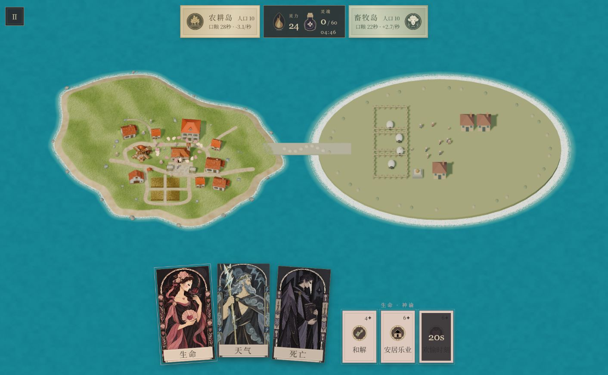

# 人间牧场玩法改动与本地测试

测试日期：2026年10月31日。工程：`C:\god_mobile`。测试代码：`main` 的 `43a0ee9`。本轮只改玩法、配置、测试和文档，模型、地编资源、UI和渲染脚本保持原样。

**新局到胜利结算已实机跑通，玩法规则已生效；表现接入和难度平衡仍需继续。** 本次浏览器操作在175秒收集78/60魂。欢愉的停工代价可见，但后期人口聚集使陨石过于高效，不能据此判定平衡完成。

## 一 本次改了什么

| 系统 | 修改前 | 修改后 |
| --- | --- | --- |
| 两国食物来源 | 农牧主要使用相同的居民自动产粮规则 | 农耕由完工农田和真实工人产粮；畜牧先繁殖羊群，再实际宰羊入库 |
| 住房和人口 | 未形成真实住房约束 | 农耕开局2座民房，每座5个床位；普通生育需有住房、口粮和生产余量 |
| 建筑发展 | 场景中的建筑未对应一套逐步施工规则 | 先建固定地编槽位，同类位置用完才外扩；住宅向北、农田向南，位置确定后不移动 |
| 特殊建筑 | 特殊模型不对应人口、余粮驱动的转型 | 议事厅、粮仓、风车、学院所在槽位先作为民房，满足条件后原地升级；先预留搬迁床位 |
| 施工 | 缺少真实人力、资源和野外阻碍 | 消耗粮食并占用真实平民；外扩先开垦，附近野兽会阻碍施工，可狩猎或神罚清理 |
| 欢愉 | 催生代价不足 | 人类停工18秒，催生可暂时越过住房与粮食门槛；之后36秒食量翻倍。羊和野兽加快繁殖，羊可叠加雨天 |
| 暴怒 | 主要用于直接组织出征 | 精准影响最近一个目标；国王下令征兵、平民伤人停工、学士袭击同窗、动物加强攻击性 |
| 社会角色 | 缺少独立角色规则 | 国王来自现有人口，死亡后继任；农耕学院完工、人口至少50且有余粮产能时可产生学士 |
| 战争意图 | 停战后可能残留待发命令 | 和解取消双方待发战令、国王和士兵怒气，并让部队返乡；厌战时连续强征会积累民变压力 |
| 饥荒与保存 | 新增系统缺少对应状态 | 按实际供粮比例累计饥饿，少量入库不再重置全体饥饿；v6存档保存建筑、羊群、角色及技能后续阶段 |

农耕固定槽位包括6座普通民房、4个特殊建筑位置、4片农田。住宅和农田分别判断自己的固定位置是否用完。施工和升级消耗真实工作时间；不会凭空增加工人或把正在施工的建筑计为产能。

畜牧开局12只羊，其中6只成年，3个牧栏共容纳96只。每只羊实际死亡入库12粮，野兽死亡入库8粮；动物不计灵魂，也不能重复结算肉。畜牧的“产量”接口返回可持续供肉预测，只有真正宰羊才会增加储粮。

当前挑战仍是300秒收60魂、每岛人口上限80；没有把Godot版50年规则直接搬进手机版。本轮只扩展农耕国建造，未加入完整科技时代、长期军事占领或畜牧国建造系统。学士目前产生研究点数，尚不推进新科技时代。

## 二 本地实机测试结果

通过本地网页 `http://127.0.0.1:5173/` 刷新版本，从主菜单开始新局，按正常点击施法完成一局。没有改人口、灵力、冷却或游戏速度。共使用1次欢愉、1次降雨、1次闪电和2次陨石。

| 检查项 | 实机观察 | 结论 |
| --- | --- | --- |
| 新局与界面数据 | 开局双方各8人、80粮，共30灵力；显示5分钟、60魂目标 | 启动和默认规则正常 |
| 人类欢愉的代价 | 农耕施法后10人，净产粮显示−3.1/秒；随后14人时口粮只余约7秒 | 停工和粮食压力已体现，不能把欢愉当作无代价增益 |
| 牧业降雨 | 施法消耗5灵力，出现降雨；畜牧人口继续增长，供肉预测改善 | 气候施法和牧业联动进入实机；羊群数量的画面仍未接入 |
| 闪电结算 | 命中居民后灵魂从0变1；灵力扣3并因收魂返2，19变18 | 单体击杀与奖励一致 |
| 农耕国陨石 | 陨石及随后火场阶段，灵魂从1增到19，农耕人口明显下降 | 范围伤害及后续死亡有效；这18魂是该阶段累计，不能当作瞬时命中人数 |
| 高人口收割 | 畜牧80人时向密集区施放第二发陨石，人口变21，灵魂19变78 | 同一次结算增加59魂，触发胜利，也暴露收割偏容易的问题 |
| 胜利流程 | 结算页显示“灵魂集齐”、78/60魂、用时175秒 | 完整一局通过 |
| 运行异常 | 本次标签的控制台错误和警告记录为空 | 本次流程未记录到运行异常，不代表完成真机性能验收 |

欢愉施法后的画面和记录：

本次实机没有逐项验收国王民变、学士暴怒、野兽掉肉或所有战争流程。这些有自动规则测试覆盖，但身份和动物的表现尚未接入，不能描述为“已在画面中确认”。未进行真实手机帧率、发热及长时间稳定性测试。

## 三 用运行数据确认建造和食物链

为了验证画面暂时没显示出来的施工、羊群和学院，另用同一份游戏代码跑了一局固定种子11、无玩家干预的300秒模拟。下面是这局的结果，**不是上面浏览器通关局的隐藏数据**。

| 游戏时间 | 农耕人口 | 完工民房 | 完工农田 | 畜牧人口 | 存活羊 | 累计宰羊 |
| --- | ---: | ---: | ---: | ---: | ---: | ---: |
| 开局 | 8 | 2 | 2 | 8 | 12 | 0 |
| 30秒 | 13 | 4 | 2 | 13 | 16 | 13 |
| 60秒 | 21 | 5 | 4 | 21 | 25 | 30 |
| 120秒 | 41 | 9 | 5 | 58 | 65 | 103 |
| 180秒 | 53 | 11 | 6 | 80 | 95 | 292 |
| 300秒 | 80 | 16 | 10 | 80 | 95 | 777 |

住宅数不包含已转型的特殊建筑。该种子约69.45秒完成第一片外扩农田；约82.55秒升级议事厅、100.70秒升级粮仓、150.20秒升级风车、167.35秒升级学院。结束时农耕研究点约52.6，存粮900；畜牧存粮592。自然观察只有1魂，超时失败，没有自动完成收割目标。

这组数据说明“住房和农田逐步增加”“保留羊群并持续宰羊供粮”“特殊建筑原地转型”已经在玩法层执行。同时，畜牧在中期会明显领先人口：120秒为58对41，180秒为80对53。这是目前住房、施工和畜牧繁殖共同作用下的节奏，不应仅凭两国最后都到80人便称为全过程均衡。

代码提交前已通过63项测试和15组多种子模拟，报告见 [自动验证记录](validation/gameplay/2026-10-31.json)。本次追加的逐时数据见 [自然发展记录](validation/gameplay/playtest-2026-10-31/growth-trace.json)。5个固定种子的回归结果和单局手动通关都不能代表玩家总体胜率。

## 四 已确认的待办与协作接口

| 优先级 | 当前问题 | 后续处理边界 |
| --- | --- | --- |
| 先接入 | 农耕场景开局仍显示完整地编建筑，看不到施工和外扩；特殊建筑也还未先显示民房 | 表现方按建筑`state`显隐，按`sourceNames`绑定现有对象，按`kind`原地换模；不要更改地编变换 |
| 先接入 | 真实羊群和野兽已参加玩法，画面却仍是旧装饰羊；无法据画面可靠定位动物 | 表现方按`world.gameplaySnapshot().animals`绑定实体，并移除旧装饰羊，避免重复展示 |
| 先接入 | 国王和学士缺少外观区分，暴怒瞄准仍使用旧版招兵预览 | 表现方读取`role`、`schoolId`等字段，统一调用`world.preview()`显示真实命中目标；不要从预览再生成士兵 |
| 后续校准 | 人口集中加半径5、100伤害的陨石，单发击杀59/80人；养起来再砸即可较轻松获胜 | 玩法侧优先评估范围与距离伤害衰减，再重测成本和冷却；本次仅记录，没有再次改数值 |
| 后续校准 | 中期畜牧人口增长快于农耕 | 结合住房施工、保种和生育门槛继续评估；不要靠表现层补人口或补粮 |
| 显示说明 | 畜牧界面的“+/秒”来自可持续供肉预测，不是粮仓每秒实际变化 | 表现方区分产能预测和实际入库；不能把预测值再加一次粮 |

给表现方的权威入口是`world.gameplaySnapshot()`，包括建筑、动物、角色和经济状态；`world.changes`用于短事件反馈，队列过期或读档后从快照恢复。详细字段、配置位置、事件和接入步骤见 [玩法逻辑交接](玩法逻辑交接.md)。

本轮没有修改`app.js`、`ui.js`、`scene.js`、`spell-effects.js`、`style.css`、`index.html`以及模型、贴图和地编清单。本次测试追加的只有说明、截图和数据证据。v5旧存档不兼容，试玩请开始新局。

## 五 文件位置和复测

- 本说明：`整理输出/玩法改动与本地测试.md`。
- 技术交接：`整理输出/玩法逻辑交接.md`。
- 本次截图、通关界面文本和运行数据：`整理输出/validation/gameplay/playtest-2026-10-31/`。
- 配置：`整理输出/game/rules.json`中的`config`、`settlement`、`husbandry`、`wildlife`、`society`。

在工程根目录执行`npm run dev`，打开本地网页并开始新局。执行`npm run audit:gameplay`可重新运行规则测试和15组自动策略；它会输出当天的JSON报告。浏览器已留在本次胜利结算页，可点击“再玩一局”继续试玩。
